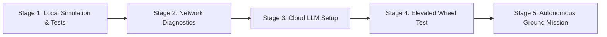

# Staged Deployment Guide for Duckiebot DB21J

This guide explains how to transition this software system from local simulation to autonomous operation on `entebot209`.



---

## Stage 1: Local Development & Simulation Validation

Before touching the physical robot, run and verify the system on your development computer.

1. **Install Dependencies**:
   ```bash
   pip install -r requirements.txt
   ```
2. **Execute Automated Test Suite**:
   ```bash
   python -m pytest tests/ -v
   ```
   Confirm all 23 tests pass.
3. **Launch the Mission Dashboard in Simulation Mode**:
   ```bash
   python scripts/run_system.py
   ```
   Open `http://localhost:8000`.
   - Test natural-language prompts: `"Go to the laboratory"`, `"Find the red object near the entrance"`.
   - Observe simulated camera feed with annotated bounding boxes and yellow/white lane overlays.
   - Click `Start Navigation`, `Pause`, `Resume`, `Stop`, and `EMERGENCY STOP`.

---

## Stage 2: Connect to Duckiebot Network

1. Power on the Duckiebot battery.
2. Connect your laptop / workstation to the hotspot (`duckietown / quackquack`).
3. Run the diagnostic probe:
   ```bash
   python scripts/test_duckiebot.py
   ```
   Confirm `entebot209.local` resolves and ports 80, 8085, and 9090 are reported open.

---

## Stage 3: Configure Cloud LLM (Gemini or OpenAI)

1. Obtain a Google Gemini API Key from Google AI Studio ([aistudio.google.com](https://aistudio.google.com/)).
2. Set your environment variable:
   - On Windows (PowerShell):
     ```powershell
     $env:GEMINI_API_KEY="AIzaSy..."
     ```
   - On Linux / macOS (Bash):
     ```bash
     export GEMINI_API_KEY="AIzaSy..."
     ```
   Alternatively, copy `config/.env.example` to `config/.env` and insert your key.
3. When `GEMINI_API_KEY` is present, the system automatically uses cloud LLM reasoning with schema validation. If the key is unset, it runs in heuristic mock mode with zero downtime.

---

## Stage 4: Switch to Hardware Mode with Elevated Wheels

1. Edit `config/config.yaml`:
   ```yaml
   system:
     mode: "hardware"

   robot:
     name: "entebot209"
     hostname: "entebot209.local"

   safety:
     enable_hardware_movement: true
   ```
2. Place the Duckiebot on a stand so its wheels do not touch the ground.
3. Launch the system:
   ```bash
   python scripts/run_system.py
   ```
4. Verify the camera preview shows live video from the Jetson Nano camera.
5. Submit a command: `"Follow the lane"`, click **Start Navigation**, and confirm wheel rotation.
6. Press the red **EMERGENCY STOP** button and confirm wheels immediately brake.

---

## Stage 5: Autonomous Arena Deployment

1. Place the Duckiebot on an enclosed Duckietown mat or track.
2. Mark landmarks with recognizable objects:
   - Laboratory: Bottle (or blue marker)
   - Entrance: Box (or brown marker)
   - Pickup point: Cup (or white marker)
3. Enter destination: `"Go to the laboratory"`.
4. Monitor live progress, detected obstacles, and lane alignment from the web dashboard.
